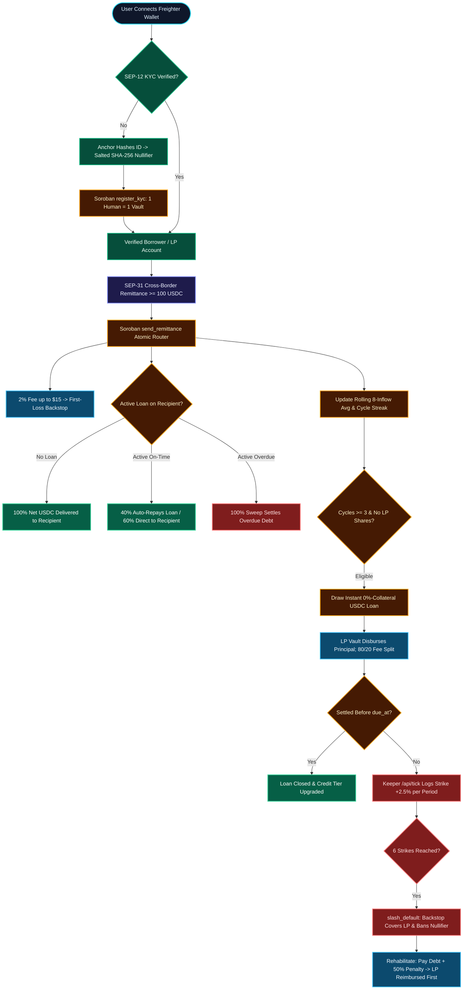

<div align="center">


<a href="https://remit-credit-ghnu.vercel.app/">
  
</a>

<br/>

<a href="https://remit-credit-ghnu.vercel.app/"></a>

<br/><br/>


<br/>


<br/><br/>

<blockquote>
<h3>“Your Remittance. Your Credit. Your Financial Freedom.”</h3>
<b>Zero-Crypto-Collateral Cross-Border Remittance Credit &amp; ERC-4626 Liquidity Protocol</b><br/>
on <b>Stellar Soroban</b> &nbsp;·&nbsp; <b>SEP-12 &amp; SEP-31 Native</b>
</blockquote>

</div>


<!-- ═══════════════════════════ NAV ═══════════════════════════ -->
<div align="center">

[**Overview**](#-brief-overview) &nbsp;•&nbsp;
[**Important**](#-important) &nbsp;•&nbsp;
[**Problem → Solution**](#-uniqueness-problem--solution) &nbsp;•&nbsp;
[**Workflow**](#-workflow) &nbsp;•&nbsp;
[**Tiers & Fees**](#-credit-tiers--all-protocol-fees) &nbsp;•&nbsp;
[**Flowcharts**](#-flowchart-1--color-coded-protocol-lifecycle) &nbsp;•&nbsp;
[**Architecture**](#-system-architecture) &nbsp;•&nbsp;
[**Contracts**](#-blockchain-and-smart-contract-layer) &nbsp;•&nbsp;
[**Structure**](#-project-structure) &nbsp;•&nbsp;
[**Deploy**](#-deployment-info) &nbsp;•&nbsp;
[**Contact**](#-connect--contact)

</div>


## ⚡ Protocol at a Glance

<div align="center">

<table>
<tr>
<td align="center" width="16%"><h1>0%</h1><sub><b>CRYPTO<br/>COLLATERAL</b></sub></td>
<td align="center" width="16%"><h1>50%</h1><sub><b>LTV ON ROLLING<br/>8-INFLOW AVG</b></sub></td>
<td align="center" width="16%"><h1>2.0%</h1><sub><b>REMIT FEE<br/>(CAP $15)</b></sub></td>
<td align="center" width="16%"><h1>40/60</h1><sub><b>ATOMIC<br/>WATERFALL</b></sub></td>
<td align="center" width="16%"><h1>6</h1><sub><b>STRIKES BEFORE<br/>SLASH DEFAULT</b></sub></td>
<td align="center" width="16%"><h1>100</h1><sub><b>MIN USDC<br/>REMIT / LP</b></sub></td>
</tr>
</table>

</div>

---

## 🌐 Brief Overview

**RemitCredit** is a decentralized Real-World Asset (RWA) cash-flow underwriting and liquidity protocol built on **Stellar Soroban**. It converts recurring cross-border USDC remittance inflows into instant, **0% crypto-collateralized** microcredit lines for migrant families and micro-entrepreneurs, while safeguarding Liquidity Providers (LPs) through a self-funded **First-Loss Backstop Reserve**, **ERC-4626 pro-rata vault shares**, **SEP-12 Sybil-resistant identity nullifiers**, and an **atomic repayment waterfall**.

| | Detail |
| :-- | :-- |
| 🚀 **Live Production App** | [https://remit-credit-ghnu.vercel.app/](https://remit-credit-ghnu.vercel.app/) |
| 🌍 **Network** | Stellar Testnet (`Test SDF Network ; September 2015`) |
| 💵 **Settlement Asset** | 7-Decimal USDC Stellar Asset Contract (`SAC`) |
| 🦀 **Smart Contract** | Rust / Soroban SDK (`RemitCredit v3`) |

---

## 🛡️ Important

> [!IMPORTANT]
> Read these guardrails first. They define how the protocol protects borrowers, LPs, and identity.

- 🔓 **Zero Crypto Collateral:** Borrowers never lock XLM or USDC upfront; credit limits are underwritten strictly from verified on-chain remittance cash flows (`50% LTV` on a rolling 8-inflow average).
- 📏 **Minimum Transaction Guardrails:**
  - **Cross-Border Remittance (`send_remittance`):** Minimum **100.00 USDC** net delivery per wire.
  - **Liquidity Pool Supply (`deposit_liquidity`):** Minimum **100.00 USDC** per LP deposit.
- 🔀 **Mutual-Exclusion Role Guard:** Active Liquidity Providers cannot draw loans while holding LP shares, and borrowers with an open loan obligation cannot deposit into the LP vault until settled.
- 🕵️ **Wallet-Scoped Privacy & Auditability:** All account ledgers, remittance streams, and LP flow histories remain hidden when disconnected and scope strictly to the connected Freighter public key in Indian Standard Time (IST).
- 🧬 **Zero-PII Identity Attestation:** Raw government IDs never touch Google Sheets or Stellar; only a deterministic salted SHA-256 32-byte nullifier is stored on-chain (`1 Human = 1 Credit Vault`).

---

## 🧩 Uniqueness, Problem & Solution

### 🔴 The Problem

| # | Pain Point | Why It Hurts |
| :-: | :-- | :-- |
| **1** | **Collateral Exclusion in DeFi** | Overcollateralized lending protocols demand 120%–150% upfront crypto assets, locking out unbanked and underbanked remittance recipients who rely on regular cross-border family transfers. |
| **2** | **Unrecognized Cross-Border Cash Flows** | Millions of migrant households receive consistent monthly remittances, yet traditional banks and Web3 protocols treat every wire as isolated payment volume rather than verifiable creditworthiness. |
| **3** | **High Default & Sybil Risk in Unsecured Lending** | Without identity binding and automated collection rails, undercollateralized on-chain lending suffers from multi-wallet Sybil farming and high repayment friction. |

### 🟢 The Solution

| # | Mechanism | How It Works |
| :-: | :-- | :-- |
| **1** | **Cash-Flow Underwriting via Rolling 8-Inflow Windows** | RemitCredit tracks verified SEP-31 remittances on-chain and computes a sliding 8-transfer average at **50% Loan-to-Value (LTV)** across 4 progressive microcredit tiers. |
| **2** | **Atomic 40/60 Repayment Waterfall** | Whenever an inbound remittance arrives for a borrower with an active loan, Soroban splits the settlement atomically, routing **40%** toward loan repayment and **60%** directly to the family wallet (or **100%** debt sweep if overdue). |
| **3** | **Self-Funded First-Loss Backstop & Pro-Rata LP Protection** | A **2.0%** remittance fee (capped at **$15.00 USDC**) and **20%** of loan fees continuously capitalize an on-chain First-Loss Backstop Reserve that absorbs defaults before LP capital is touched. |

### 💎 What Makes RemitCredit Unique

- 🎯 **Exact-Delivery Wire Quotation:** Pre-computes gross sender debit off-chain so recipients always receive 100% of the intended payout.
  ```text
  gross = ceil(targetNet * 10,000 / 9,800)
  ```
- 🚨 **6-Strike Overdue Guard & LP-First Rehabilitation:** Overdue loans accrue `+2.5%` per elapsed period up to 6 strikes before `slash_default` suspends the wallet and SEP-12 nullifier. Rehabilitating a suspended account (`debt + 50% penalty`) reimburses LPs **first** (principal + 100% of strike fees) before replenishing the Backstop.
- 🤖 **Zero-Idle-Cost Serverless Keeper:** Driven on-demand via Vercel `/api/tick` whenever a user opens or interacts with the dApp, indexing Soroban events to Google Sheets, extending Persistent ledger TTLs, and enforcing overdue defaults without requiring an always-on VM.


## 🔄 Workflow

<table>
<tr>
<td width="6%" align="center"><h2>01</h2></td>
<td>

### 🪪 Wallet Connection & SEP-12 KYC Binding
- User connects **Freighter** on Stellar Testnet and submits identity details off-chain to the Anchor (`/api/sep12/customer`).
- The Anchor computes `SHA256(salt : country : id_type : normalized_id)` and invokes `register_kyc(beneficiary, nullifier)` on Soroban, binding 1 human to 1 credit vault.

</td>
</tr>
<tr>
<td align="center"><h2>02</h2></td>
<td>

### 🌍 Cross-Border SEP-31 Remittance Corridor (`Min 100 USDC`)
- A sender enters a recipient address and target net payout (`≥ 100 USDC`).
- `send_remittance()` atomically routes the **2.0%** Backstop fee (capped at `$15 USDC`), updates the recipient's rolling 8-inflow average and cycle streak, and executes the **40/60 waterfall** if a loan is active.

</td>
</tr>
<tr>
<td align="center"><h2>03</h2></td>
<td>

### 💳 Zero-Collateral Credit Draw (`borrow`)
- Once a borrower completes `≥ 3` verified remittance cycles, they select a custom maturity (**2 minutes to 30 days**) and draw up to `min(8_inflow_avg * 50%, tier_cap, available_liquidity)` in instant USDC.

</td>
</tr>
<tr>
<td align="center"><h2>04</h2></td>
<td>

### 🏦 Liquidity Provision & Yield Accrual (`Min 100 USDC`)
- LPs deposit `≥ 100 USDC` into the ERC-4626 pro-rata share vault (`deposit_liquidity`), earning **80%** of all flat **2.5%** loan fees and withdrawing pro-rata idle liquidity at any time (`withdraw_liquidity`).

</td>
</tr>
<tr>
<td align="center"><h2>05</h2></td>
<td>

### ⚖️ Automated Settlement, Overdue Strikes & Rehabilitation
- Borrowers repay via incoming remittance waterfalls or manual `repay()` calls. If a loan passes `due_at`, the serverless keeper invokes `slash_default()` on app load/heartbeat to record overdue strikes and enforce 6-strike bans.

</td>
</tr>
</table>

---

## 📈 Credit Tiers & All Protocol Fees

### 🪜 4-Tier Progressive Credit Matrix

```text
Credit Limit = min( Rolling 8-Inflow Average x 50% ,  Tier Hard Cap ,  Available Pool USDC )
```

```text
 TIER 4  ▓▓▓▓▓▓▓▓▓▓▓▓▓▓▓▓▓▓▓▓▓▓▓▓▓▓▓▓▓▓▓▓▓▓▓▓▓▓▓▓  $400  ◆ SOVEREIGN MAX
 TIER 3  ▓▓▓▓▓▓▓▓▓▓▓▓▓▓▓▓▓▓▓▓                        $200  ◆ ESTABLISHED
 TIER 2  ▓▓▓▓▓▓▓▓▓▓                                  $100  ◆ VERIFIED STREAM
 TIER 1  ▓▓▓▓▓                                        $50  ◆ UNLOCKED STARTER
 TIER 0  ░                                             $0  ◆ LOCKED
```

| Tier | Classification | Min Verified Cycles | Loans Repaid | Min Rolling 8-Inflow Avg | Max Credit Cap |
| :--- | :--- | :--- | :--- | :--- | :--- |
| **Tier 0** | 🔒 Locked | `< 3` | `0` | Any | **$0.00 USDC** |
| **Tier 1** | 🌱 Unlocked Starter | `≥ 3` | `0+` | `> $0.00` | **$50.00 USDC** |
| **Tier 2** | 🌿 Verified Stream | `≥ 6` | `≥ 1` | `≥ $100.00` | **$100.00 USDC** |
| **Tier 3** | 🌳 Established | `≥ 10` | `≥ 2` | `≥ $200.00` | **$200.00 USDC** |
| **Tier 4** | 👑 Sovereign Max | `≥ 15` | `≥ 4` | `≥ $400.00` | **$400.00 USDC** |

### 💰 Complete Fee, Waterfall & Risk Schedule

| Parameter | Rate / Value | Routing & Enforcement |
| :--- | :--- | :--- |
| **Minimum Remittance Amount** | **100.00 USDC** | Enforced in UI & exact-delivery wire router |
| **Minimum LP Supply Deposit** | **100.00 USDC** | Enforced in Liquidity Vault deposit flow |
| **Remittance Protocol Fee** | **2.00%** (`200 bps`) | Capped at **$15.00 USDC**; **100%** routed to First-Loss Backstop Reserve |
| **Loan Origination Fee** | **2.50%** (`250 bps`) flat | **80.0%** to Liquidity Providers · **20.0%** to First-Loss Backstop Reserve |
| **Loan Maturity Window** | **2 Mins – 30 Days** | Configurable per draw (`120s` to `2,592,000s`) |
| **On-Time Repayment Waterfall** | **40.0% / 60.0%** | **40%** auto-repays active loan · **60%** forwarded directly to recipient |
| **Overdue Repayment Waterfall** | **100.0% Sweep** | **100%** of incoming remittance sweeps overdue debt first |
| **Overdue Strike Penalty** | **+2.50%** per period | Up to **6 strikes**; Strike 6 triggers `slash_default` & wallet/nullifier ban |
| **Account Rehabilitation Cure** | **Debt + 50.0% Penalty** | Reimburses LPs **first** (principal + 100% strike fees), remainder to Backstop |


## 🗺️ Flowchart 1 — Color-Coded Protocol Lifecycle



---

## 🧱 Flowchart 2 — Text-Box Execution Pipeline

```text
+-----------------------------------------------------------------------------------+
| 1. ONBOARDING & SYBIL SHIELD (SEP-12)                                             |
|    [Freighter Wallet] ---> [Anchor Off-Chain ID Check] ---> [Salted SHA-256]      |
|                                                                  |                |
|                                     [Soroban register_kyc(wallet, nullifier)]     |
+------------------------------------------------------------------|----------------+
                                                                   v
+-----------------------------------------------------------------------------------+
| 2. ATOMIC REMITTANCE & WATERFALL ENGINE (SEP-31 · MIN 100 USDC)                   |
|    [Sender Wire >= 100 USDC] ---> [send_remittance()]                            |
|                                         |                                         |
|            +----------------------------+----------------------------+            |
|            |                            |                            |            |
|            v                            v                            v            |
|    [2% Fee (Cap $15)]         [Rolling 8-Inflow Avg]       [Active Loan Check]    |
|    -> Backstop Reserve        -> Unlocks Tiers 1-4         -> On-Time: 40% / 60%  |
|                                                            -> Overdue: 100% Sweep |
+------------------------------------------------------------------|----------------+
                                                                   v
+-----------------------------------------------------------------------------------+
| 3. ZERO-COLLATERAL CREDIT & PRO-RATA LP VAULT (ERC-4626)                          |
|    [LP Deposits >= 100 USDC] ---> [Pro-Rata Vault Shares] <--- [Borrower Draws]   |
|                                         |                      (50% LTV, 0% Coll) |
|                                         v                                         |
|                     [2.5% Loan Fee: 80% LP Yield / 20% Backstop]                  |
+------------------------------------------------------------------|----------------+
                                                                   v
+-----------------------------------------------------------------------------------+
| 4. SERVERLESS KEEPER & 6-STRIKE RISK GUARD (/api/tick)                            |
|    [Frontend Open / 20s Heartbeat] ---> [Vercel FastAPI /api/tick]                |
|         |                                     |                                   |
|         v                                     v                                   |
|    [Index Events -> Google Sheets IST]   [Check Overdue -> slash_default()]       |
|                                               |                                   |
|                                               +--> [6 Strikes: Ban + Backstop]    |
|                                               +--> [Cure (+50%): LP Paid First]   |
+-----------------------------------------------------------------------------------+
```


## 🏗️ System Architecture

```text
+-----------------------------------------------------------------------------------+
|                        CLIENT LAYER (React 18 + Vite + TS)                        |
|  - Freighter Wallet Signing (@stellar/stellar-sdk)                                |
|  - Active-Tab Heartbeat: Triggers POST /api/tick on mount & every 20s             |
|  - Wallet-Scoped Views: Overview, Remit, Credit Vault, LP Pool, History, KYC      |
+-----------------------------------------+-----------------------------------------+
                                          |
                     +--------------------+--------------------+
                     | HTTPS / REST (/api/*)                   | Soroban RPC / Horizon
                     v                                         v
+-----------------------------------------+   +-------------------------------------+
|   SERVERLESS KEEPER LAYER (Vercel)      |   |   STELLAR TESTNET BLOCKCHAIN        |
|  - api/index.py (FastAPI Serverless)    |   |  - RemitCredit v3 Soroban Contract  |
|  - /api/tick: Full sweep (events, TTLs, |   |  - USDC Stellar Asset Contract (SAC)|
|    overdue strikes, 6-strike bans)      |   |  - Persistent Ledger Storage (TTL)  |
|  - /api/sep12/customer: Nullifier bind  |   +------------------+------------------+
|  - /api/history & /api/feed             |                      |
+--------------------+--------------------+                      | GetEvents / Tx
                     |                                           |
                     +--------------------+----------------------+
                                          v
+-----------------------------------------------------------------------------------+
|                   AUDIT & REGISTRY PERSISTENCE (Google Sheets)                    |
|  - Google Apps Script Web App Bridge (keeper/src/db.py)                           |
|  - Registrations Tab: Wallet <-> Salted SHA-256 Nullifier, Tier, Status           |
|  - Transactions Tab: IST-indexed ledger events (REMITTANCE_IN & REMITTANCE_OUT)   |
+-----------------------------------------------------------------------------------+
```

---

## ⛓️ Blockchain and Smart Contract Layer

The on-chain protocol is implemented in Rust using the **Soroban SDK** under `contracts/remit_credit/src/` with modular separation of concerns:

| Module | Responsibility |
| :-- | :-- |
| 🧠 **`lib.rs`** | Core contract entrypoints (`initialize`, `register_kyc`, `send_remittance`, `borrow`, `repay`, `deposit_liquidity`, `withdraw_liquidity`, `slash_default`, `rehabilitate`, `extend_borrower_ttl`, and view queries). |
| 📊 **`scoring.rs`** | Computes the sliding 8-remittance average (`recent_inflows`), enforces the 50% rolling LTV formula, and evaluates progressive Tier 1–4 thresholds. |
| 🌊 **`waterfall.rs`** | Executes atomic inbound remittance splits (`40%` loan repayment / `60%` direct recipient payout on-time; `100%` overdue debt sweep) and distributes `80% / 20%` fee yields between LPs and the First-Loss Backstop. |
| 🗄️ **`storage.rs` & `types.rs`** | Manages Instance and Persistent ledger keys (`BorrowerProfile`, `ActiveLoan`, `PoolStats`, `ProtocolConfig`, `LpPosition`, `KycNullifier`) with 60-day TTL extensions. |
| 📡 **`events.rs` & `errors.rs`** | Emits structured Soroban topics (`KycVerified`, `RemittanceLogged`, `RemitFeeCollected`, `LoanDisbursed`, `WaterfallRepaid`, `DirectRepaid`, `OverdueStrikeAdded`, `LoanDefaulted`, `AccountRehabilitated`, `LiquidityUpdated`) and deterministic contract error codes (`#1`–`#18`). |
| 🧪 **`test.rs`** | Comprehensive Soroban unit and integration test suite covering KYC Sybil guards, waterfall splits, ERC-4626 LP share math, 6-strike defaults, and LP-first rehabilitation. |

---

## 📚 More Info

- 🧰 **Generated TypeScript Client (`packages/remit-credit-client`):** Auto-generated Soroban contract bindings for type-safe RPC simulation and XDR construction.
- 🕐 **Indian Standard Time (IST) Audit Trail:** All indexed events and frontend ledger timestamps normalize UTC ledger close times into `DD-MM-YYYY HH:MM:SS IST` with one-click CSV export and Stellar Expert transaction links.
- 🔁 **Dual Outgoing & Incoming Remittance Indexing:** Every `RemittanceLogged` event writes both a `REMITTANCE_IN` record for the beneficiary and a `REMITTANCE_OUT` record for the sender so both counterparties see complete audit histories.

---

## 🗂️ Project Structure

<details>
<summary><b>📂 Click to expand the full repository tree</b></summary>

```text
Remit-Credit/
├── api/
│   └── index.py                         # Vercel Serverless FastAPI entrypoint & /api/tick sweep
├── contracts/
│   └── remit_credit/
│       ├── src/
│       │   ├── errors.rs                # Custom Soroban contract error definitions
│       │   ├── events.rs                # Structured on-chain event emitters
│       │   ├── lib.rs                   # Core contract methods & entrypoints
│       │   ├── scoring.rs               # Rolling 8-inflow average & 4-tier LTV underwriting
│       │   ├── storage.rs               # Persistent/Instance storage & TTL helpers
│       │   ├── test.rs                  # Rust smart contract test suite
│       │   ├── types.rs                 # Protocol structs, configs & state enums
│       │   └── waterfall.rs             # Atomic 40/60 repayment split & yield routing
│       └── Cargo.toml
├── frontend/
│   ├── public/                          # Static assets & Logo.png
│   ├── src/
│   │   ├── assets/
│   │   ├── components/
│   │   │   ├── borrower/
│   │   │   │   ├── BorrowModal.tsx
│   │   │   │   ├── CreditScoreGauge.tsx
│   │   │   │   ├── VaultCard.tsx
│   │   │   │   └── WaterfallFeed.tsx
│   │   │   ├── kyc/
│   │   │   │   ├── KycBanner.tsx
│   │   │   │   └── KycRegistrationModal.tsx
│   │   │   ├── layout/
│   │   │   │   ├── Footer.tsx
│   │   │   │   ├── Navbar.tsx
│   │   │   │   └── RoleSwitcher.tsx
│   │   │   ├── lender/
│   │   │   │   ├── BackstopMetricsCard.tsx
│   │   │   │   └── LiquidityPoolCard.tsx
│   │   │   └── simulator/
│   │   │       └── AnchorSimulator.tsx
│   │   ├── config/
│   │   │   └── stellar.ts
│   │   ├── context/
│   │   │   └── WalletContext.tsx
│   │   ├── hooks/
│   │   │   ├── useAccountHistory.ts
│   │   │   ├── useBorrowerProfile.ts
│   │   │   ├── useKycStatus.ts
│   │   │   ├── useProtocolEvents.ts
│   │   │   └── useRemitContract.ts
│   │   ├── pages/
│   │   │   ├── AccountHistoryPage.tsx
│   │   │   ├── BorrowerDashboardPage.tsx
│   │   │   ├── KycVerificationPage.tsx
│   │   │   ├── LandingPage.tsx
│   │   │   ├── LiquidityPoolPage.tsx
│   │   │   ├── ProtocolStatusPage.tsx
│   │   │   └── SendRemittancePage.tsx
│   │   ├── utils/
│   │   │   ├── formatters.ts
│   │   │   └── stroops.ts
│   │   ├── App.css
│   │   ├── App.tsx
│   │   ├── index.css
│   │   ├── main.tsx
│   │   └── vite-env.d.ts
│   ├── index.html
│   ├── package.json
│   ├── tsconfig.json
│   └── vite.config.ts
├── keeper/
│   ├── src/
│   │   ├── api/
│   │   │   └── routes.py                # REST endpoints (/health, /sync, /sep12, /history, /feed)
│   │   ├── jobs/
│   │   │   ├── anchor_router.py         # Idempotent SEP-31 wire router
│   │   │   ├── event_indexer.py         # Soroban event decoder & dual IN/OUT sheet logger
│   │   │   └── ttl_keeper.py            # TTL keepalive & 6-strike overdue default enforcer
│   │   ├── config.py
│   │   ├── db.py                        # Google Apps Script REST bridge & history backfill
│   │   └── stellar_client.py            # Stellar SDK RPC & Horizon client
│   ├── tests/
│   │   └── test_keeper_flow.py
│   ├── requirements.txt
│   └── run.py                           # Optional local FastAPI + APScheduler runner
├── packages/
│   └── remit-credit-client/             # Generated TypeScript Soroban contract bindings
├── Cargo.toml
├── package.json
├── requirements.txt                     # Root Python dependencies for Vercel Serverless runtime
├── rust-toolchain.toml
└── vercel.json                          # Vercel build config, 60s function limit & /api rewrites
```

</details>


## 🚢 Deployment Info

| Item | Value |
| :-- | :-- |
| 🌐 **Live Application URL** | [https://remit-credit-ghnu.vercel.app/](https://remit-credit-ghnu.vercel.app/) |
| ▲ **Frontend & Serverless Hosting** | Vercel (`vercel.json` builds `frontend/dist` and mounts `api/index.py` at `/api/*`) |
| ⭐ **Stellar Network** | Testnet (`Test SDF Network ; September 2015`) |
| 📜 **RemitCredit v3 Contract ID** | `CCPRKASCF2M3SQ5XKK323KF4WKJ32IHIDAM6D75D5EMH6S6JM7KKT46P` |
| 💵 **USDC SAC Token ID** | `CDUIQMEIO3VBVUPJUCI47XRJGNW5D2LX5PJJML23DUALE3B4AC5UZTRK` |
| 🔑 **Whitelisted Anchor Public Key** | `GCF4H37C6PDJITN3WCIELT7J625PERUUWZJXYJKYZ6AZ3P3DY3XDR3E6` |

---

## 🛠️ Build & Deploy the Contract (Stellar CLI · PowerShell)

> [!NOTE]
> Replace `<YOUR_ADMIN_PUBLIC_KEY>` and `<YOUR_ANCHOR_PUBLIC_KEY>` with your own Stellar public keys. The `admin` source account must already exist in your Stellar CLI identities and be funded on Testnet.

### 1️⃣ Build, Deploy & Initialize

```powershell
cd contracts\remit_credit
stellar contract build

$env:STELLAR_NETWORK_PASSPHRASE = "Test SDF Network ; September 2015"
$USDC_SAC_ID = "CDUIQMEIO3VBVUPJUCI47XRJGNW5D2LX5PJJML23DUALE3B4AC5UZTRK"
$ADMIN_ADDR = "<YOUR_ADMIN_PUBLIC_KEY>"
$ANCHOR_ADDR = "<YOUR_ANCHOR_PUBLIC_KEY>"

$WASM_PATH = (Get-ChildItem -Path "..\.." -Recurse -Filter "remit_credit.wasm" |
    Where-Object { $_.FullName -match "release" } |
    Select-Object -First 1).FullName

$CONTRACT_ID = (stellar contract deploy `
  --wasm "$WASM_PATH" `
  --source-account admin `
  --network testnet).Trim()

stellar contract invoke `
  --id $CONTRACT_ID `
  --source-account admin `
  --network testnet `
  -- initialize `
  --admin $ADMIN_ADDR `
  --token $USDC_SAC_ID `
  --min_cycles_required 3 `
  --min_cycle_interval_secs 60 `
  --post_repay_cooldown_secs 60 `
  --remit_fee_bps 200 `
  --remit_fee_cap 150000000 `
  --waterfall_split_bps 4000 `
  --loan_fee_bps 250 `
  --backstop_fee_bps 2000 `
  --tier_1_cap 500000000 `
  --tier_2_cap 1000000000 `
  --tier_3_cap 2000000000 `
  --tier_4_cap 4000000000 `
  --loan_duration_secs 180
```

### 2️⃣ Whitelist the Anchor

```powershell
stellar contract invoke `
  --id $CONTRACT_ID `
  --source-account admin `
  --network testnet `
  -- set_anchor `
  --anchor $ANCHOR_ADDR `
  --is_verified true
```

### 🔎 `initialize` Parameter Reference

USDC uses 7 decimals, so `10,000,000` stroops = `1.00 USDC`.

| Parameter | Value | Meaning |
| :--- | :--- | :--- |
| `--admin` | `$ADMIN_ADDR` | Protocol admin public key |
| `--token` | `$USDC_SAC_ID` | 7-decimal USDC Stellar Asset Contract |
| `--min_cycles_required` | `3` | Verified remittance cycles needed before the first borrow |
| `--min_cycle_interval_secs` | `60` | Minimum seconds between counted remittance cycles |
| `--post_repay_cooldown_secs` | `60` | Cooldown after a repayment before the next draw |
| `--remit_fee_bps` | `200` | **2.00%** remittance fee → First-Loss Backstop |
| `--remit_fee_cap` | `150000000` | Fee cap of **$15.00 USDC** |
| `--waterfall_split_bps` | `4000` | **40%** of inbound remittance auto-repays an active loan |
| `--loan_fee_bps` | `250` | **2.50%** flat loan origination fee |
| `--backstop_fee_bps` | `2000` | **20%** of the loan fee to Backstop (80% to LPs) |
| `--tier_1_cap` | `500000000` | Tier 1 cap: **$50.00 USDC** |
| `--tier_2_cap` | `1000000000` | Tier 2 cap: **$100.00 USDC** |
| `--tier_3_cap` | `2000000000` | Tier 3 cap: **$200.00 USDC** |
| `--tier_4_cap` | `4000000000` | Tier 4 cap: **$400.00 USDC** |
| `--loan_duration_secs` | `180` | Default loan duration of **3 minutes** |

---

## 📬 Connect & Contact

| Platform | Link |
| :--- | :--- |
| 💼 **LinkedIn** | [https://www.linkedin.com/in/earth-kumar-roy/](https://www.linkedin.com/in/earth-kumar-roy/) |
| 🐦 **X / Twitter** | [https://x.com/Earth_Kumar_Roy](https://x.com/Earth_Kumar_Roy) |
| 👤 **GitHub** | [https://github.com/Earth-Kumar-Roy](https://github.com/Earth-Kumar-Roy) |
| 💬 **Leave a Message** | [https://sites.google.com/view/ekr1/leave-a-message](https://sites.google.com/view/ekr1/leave-a-message) |

<p align="center">
  <a href="https://www.linkedin.com/in/earth-kumar-roy/"></a>
  <a href="https://x.com/Earth_Kumar_Roy"></a>
  <a href="https://github.com/Earth-Kumar-Roy"></a>
  <a href="https://sites.google.com/view/ekr1/leave-a-message"></a>
</p>

---

## 🙏 Acknowledgement

- **Stellar Development Foundation (SDF) & Soroban Ecosystem** for Rust smart contract infrastructure, Stellar Asset Contracts (SAC), and SEP-12 / SEP-31 cross-border anchor standards.
- **Freighter Wallet** for seamless browser-based Stellar transaction signing.
- **Vercel & Google Apps Script** for enabling zero-idle-cost serverless keeper execution and transparent IST ledger auditing.

---

<div align="center">

### 💫 Thank You

Thank you for exploring **RemitCredit**, empowering global families and micro-entrepreneurs to turn everyday cross-border remittances into verifiable financial freedom.

<a href="https://remit-credit-ghnu.vercel.app/"></a>


</div>
